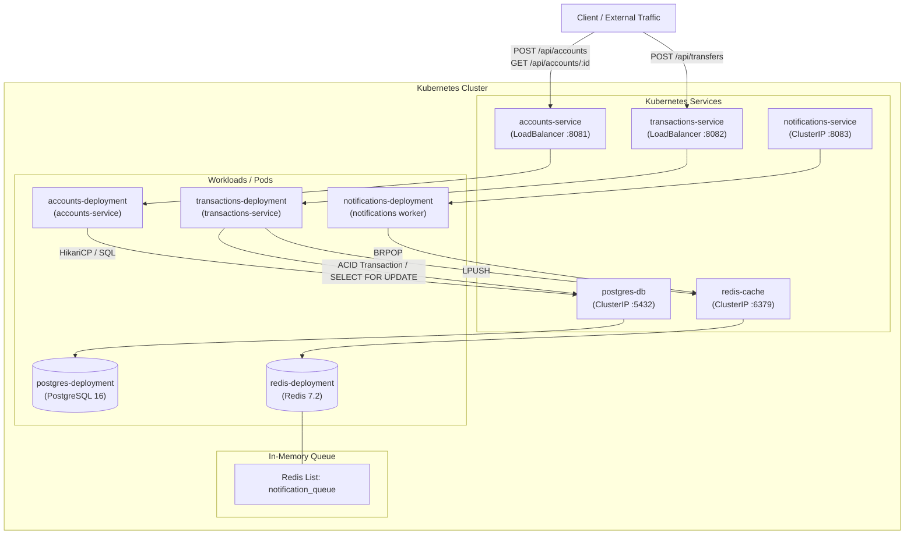

# ZKube Distributed Resilient Banking Architecture & Chaos Engine

[](https://github.com/Zainetic/zkube-distributed-resilient-banking-architecture-and-chaos-engine/actions/workflows/ci.yml)

A fully containerized, highly available, and fault-tolerant microservices banking engine built to demonstrate modern distributed systems architecture. Orchestrated via Kubernetes, this system features decoupled ACID-compliant financial transactions, asynchronous Redis-based event queuing, and programmatic resilience testing using Chaos Mesh.

This architecture demonstrates that even during infrastructure failures (such as pod termination during active transactions), financial data remains strictly consistent, message queues retain pending events, and the system achieves eventual consistency without dropped requests.

## Architecture Overview

The cluster is divided into independent, scalable domains:

- **Synchronous Accounts Service (REST):** Manages user creation and balance states, persisting directly to PostgreSQL via HikariCP connection pooling.
- **Decoupled Transactions Service (REST -> Redis):** Executes atomic database locks for transferring funds between accounts. Upon successful commit, it publishes a notification payload to a Redis queue rather than waiting for a synchronous notification response.
- **Asynchronous Notifications Worker:** A background consumer that listens to the Redis `notification_queue`. It processes the queue sequentially, ensuring delivery even if the worker pod is killed and restarted.
- **Automated Infrastructure State:** PostgreSQL is bootstrapped automatically via Kubernetes ConfigMaps, ensuring the database schema is injected and ready before the Java applications boot.

### Architecture Diagram



## Key Technical Features

- **Kubernetes Orchestration:** Implements declarative Deployments, LoadBalancers, and ClusterIP routing to ensure pods are constantly monitored and traffic is load-balanced. Strict `livenessProbe` checks ensure deadlocked or unhealthy applications are automatically terminated and restarted.
- **Event-Driven Self-Healing:** The notification worker is decoupled from the transaction execution path. If the notification pod fails, the transaction service continues committing transfers and queuing messages in Redis (`notification_queue`) until a replacement pod starts and drains the backlog.
- **Automated Data Provisioning:** Utilizes Kubernetes ConfigMaps and Volume mounts (`/docker-entrypoint-initdb.d/init.sql`) to automate database table creation (`accounts` and `transfers`) upon cluster initialization.
- **Chaos Engineering Ready:** Fully integrated with Chaos Mesh to programmatically inject pod-kill and network faults into the live cluster, verifying zero-downtime resilience and recovery under active transactional load.

## Technology Stack

- **Language:** Java 21
- **Web Framework:** Javalin 6
- **Data Access & Pooling:** jOOQ, HikariCP
- **In-Memory Datastore / Queuing:** Redis 7.2 (Alpine)
- **Relational Database:** PostgreSQL 16 (Alpine)
- **Orchestration & DevOps:** Docker, Kubernetes (Local cluster e.g., Docker Desktop / Kubeadm)
- **Chaos Engineering:** Helm, Chaos Mesh
- **Testing:** JUnit 5, REST-assured, Testcontainers

## CI & Tests

Continuous Integration is managed via GitHub Actions in [.github/workflows/ci.yml](file:///c:/Users/Neko/Documents/Zain/Java%20Projects/zkube-banking/.github/workflows/ci.yml).

### CI Pipeline Workflow

- **Trigger Conditions:** Automatically executed on every `push` and `pull_request` targeting `main` and `master` branches.
- **Runner Environment:** Ubuntu latest (`ubuntu-latest`) configured with Eclipse Temurin JDK 21 and automated Maven dependency caching.
- **Build Steps:**
  1. **Accounts Service:** Builds and runs test suites via `mvn clean package` with Testcontainers Ryuk enabled (`TESTCONTAINERS_RYUK_DISABLED="false"`).
  2. **Transactions Service:** Validates transaction logic and builds JAR artifacts via `mvn clean package`.
  3. **Notifications Service:** Compiles and packages the background worker service via `mvn clean package`.

### Test Suites

- **Accounts API Integration Tests** ([AccountsApiTest.java](file:///c:/Users/Neko/Documents/Zain/Java%20Projects/zkube-banking/accounts-service/src/test/java/com/zkube/accounts/AccountsApiTest.java)): Validates HTTP endpoints (`POST /api/accounts`) using Javalin and REST-assured, ensuring status codes and response bodies conform to specification.
- **Database Integration Tests** ([DatabaseIntegrationTest.java](file:///c:/Users/Neko/Documents/Zain/Java%20Projects/zkube-banking/accounts-service/src/test/java/com/zkube/accounts/DatabaseIntegrationTest.java)): Uses Testcontainers to spin up an ephemeral `postgres:16-alpine` container, executing schema initialization and verifying JDBC table creation and record insertion.
- **Transfer Domain Logic Tests** ([TransferLogicTest.java](file:///c:/Users/Neko/Documents/Zain/Java%20Projects/zkube-banking/transactions-service/src/test/java/com/zkube/transactions/TransferLogicTest.java)): Verifies business invariant enforcement, validating that transfers with insufficient sender balances throw runtime exceptions and transfers with sufficient balances are approved.

## Local Development & Deployment Guide

This guide walks through deploying the system from scratch to a local Docker Desktop or Kubeadm Kubernetes cluster.

### 1. Build the Docker Images

Navigate to each microservice directory and package the Java applications into Docker images. (Ensure you have run `mvn clean package` first to generate the FAT JARs).

**Build Accounts Service:**

```bash
cd accounts-service
docker build -t zkube-accounts:latest .
```

**Build Transactions Service:**

```bash
cd ../transactions-service
docker build -t zkube-transactions:latest .
```

**Build Notifications Service:**

```bash
cd ../notifications-service
docker build -t zkube-notifications:latest .
```

**Return to root directory:**

```bash
cd ..
```

### 2. Deploy Infrastructure & Databases

Deploy the persistence layer first. This applies the ConfigMap containing the SQL initialization scripts, spins up Redis, and boots PostgreSQL:

```bash
kubectl apply -f k8s/01-infrastructure.yaml
```

Wait for the database and cache pods to reach the `Running` state:

```bash
kubectl get pods -w
```

### 3. Deploy the Microservices

Once the database and cache pods are running (1/1 Running), deploy the Java microservices:

```bash
kubectl apply -f k8s/02-microservices.yaml
```

### 4. Verify Cluster Health

Check that all pods are running and stable:

```bash
kubectl get pods
```

Check services and assigned ports:

```bash
kubectl get svc
```

> [!NOTE]
> `accounts-service` is exposed on port 8081 and `transactions-service` on port 8082.

## Chaos Engineering (Resilience Testing)

To prove system fault tolerance, Chaos Mesh is used to simulate server and pod failures during active transaction processing.

### 1. Install Helm (Windows)

If Helm is not installed, install it using the Windows Package Manager:

```bash
winget install Helm.Helm
```

*(Restart your terminal after installation).*

### 2. Install Chaos Mesh Operator

Add the Chaos Mesh repository and install the operator into an isolated namespace:

```bash
helm repo add chaos-mesh https://charts.chaos-mesh.org
helm repo update
helm install chaos-mesh chaos-mesh/chaos-mesh -n chaos-mesh --create-namespace
```

Wait for the Chaos Mesh pods to reach the `Running` state:

```bash
kubectl get pods -n chaos-mesh -w
```

### 3. Access the Chaos Mesh Dashboard

Chaos Mesh provides a web dashboard for configuring and observing experiments.

**A. Open Port-Forwarding (Keep this terminal running):**

```bash
kubectl port-forward -n chaos-mesh svc/chaos-dashboard 2333:2333
```

**B. Generate Authentication Token (Open a new terminal):**

Create Admin ServiceAccount:

```bash
kubectl create serviceaccount chaos-admin -n chaos-mesh
```

Grant Cluster-Admin Role:

```bash
kubectl create clusterrolebinding chaos-admin-binding --clusterrole=cluster-admin --serviceaccount=chaos-mesh:chaos-admin
```

Generate Authentication Token (48-hour expiration):

```bash
kubectl create token chaos-admin -n chaos-mesh --duration=48h
```

> [!NOTE]
> The `cluster-admin` role binding for `chaos-admin` is intended strictly for local lab and development clusters. In production environments, adhere to the principle of least privilege by scoping RBAC permissions to specific namespaces and resources.

**C. Execute the Chaos Experiment:**

1. Copy the generated token.
2. Open `http://localhost:2333` in your browser.
3. Paste the token to authenticate.
4. Create an experiment under **Pod Fault** -> **Pod Kill** targeting `app: transactions` with a continuous or recurring schedule.

### 4. Observe Resilience and Self-Healing

While the chaos experiment is active, stream logs from the decoupled notification worker:

```bash
kubectl logs deployment/notifications-deployment -f
```

Generate concurrent traffic against the Transactions API (e.g., using Postman Runner, curl, or k6). As pods are terminated by Chaos Mesh, Kubernetes automatically redirects traffic to healthy pods and spins up replacements. Transactions complete successfully (`200 OK`), and the Redis queue safely preserves all notifications until a worker pod processes the backlog.

## API Documentation

### 1. Create Account

- **Endpoint:** `POST http://localhost:8081/api/accounts`
- **Request Body:**

```json
{
  "ownerName": "Alice",
  "balance": 1000.00
}
```

### 2. Execute Transfer (Atomic)

- **Endpoint:** `POST http://localhost:8082/api/transfers`
- **Request Body:**

```json
{
  "fromAccount": "uuid-of-alice",
  "toAccount": "uuid-of-bob",
  "amount": 150.00
}
```

### 3. Kubernetes Health Probes

Used internally by Kubernetes `livenessProbe` and `readinessProbe` to verify pod availability.

- **Endpoint:** `GET http://localhost:8082/api/transactions/health`
- **Response:**

```json
{
  "status": "UP",
  "service": "transactions"
}
```

*(Health checks are also available on port 8081 at `/api/accounts/health` and on port 8083 at `/api/notifications/health`).*

## Results

TODO
